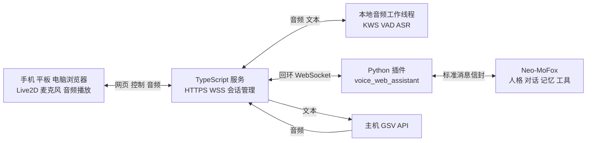

# Neo-MoFox 本地语音助手项目方案

本项目把现有 Neo-MoFox bot 接到一个本地网页上：电脑负责对话、语音识别和语音合成，手机、平板或其他电脑打开网页后，可以对着自己的 Live2D 角色说话。体验目标是类似“小爱同学”的叫名唤醒和语音对话，回复内容来自用户自己的 bot。

采用 **npm + Vue 3 + TypeScript 前端、TypeScript 服务和 Python 适配器插件**。本文从旧 `G:\语音助手` 迁入新仓库 `G:\mofox-Voice-assistant`，保留原始方案供对照。下面原方案中的接口和性能指标是设计约定；当前实际启动命令、配置字段和运行边界以仓库 README 与 `packages/protocol/src/index.ts` 为准。

2026 年 10 月 3 日实施进展：已实现 Vue 网页、模型目录/ZIP 导入、音频重采样、配对与会话桥接、GSV 分段合成与播放回执、SenseVoice Worker、中文 KWS 及本地 HTTPS 证书脚本。已导入用户蓝音模型并配置本机玛德蕾娜参考音频，ASR/KWS 原生引擎实测可加载和推理。Python 插件复用启用的原 Neo 聊天 Service，不修改其他平台的 Chatter。真实 bot 模型回复与真机麦克风效果需要启动目标服务后联调。

文档日期：2026 年 10 月 2 日。检查对象：`G:\Neo-MoFox`，本地提交 `0348a93`，`pyproject.toml` 标记版本为 `1.3.0-alpha.0`。

## 项目目标

首个完整版本应实现以下功能：

- 电脑启动服务后，同一局域网的设备通过浏览器访问。
- 导入用户提供的 Live2D 运行模型，支持切换、缩放、拖动和基础动作。
- 提供文本输入、按键说话和自定义唤醒词三种入口。
- 将识别出的文本发送给现有 Neo-MoFox，由其生成回复。
- 通过电脑上的 GSV API 合成语音，在发起对话的设备上播放。
- 根据实际播放音频驱动角色嘴型，并显示待唤醒、倾听、思考和说话状态。
- 支持连接恢复、错误提示、停止播报及不同设备的会话隔离。

“本地”指网页、音频处理和 GSV 服务可以部署在主机上。Neo-MoFox 当前使用的大模型、记忆工具或其他插件如果调用外部服务，整个系统仍会依赖那些服务；本项目不会把它们自动改成本地推理。

## 使用流程

1. 在电脑上运行 Neo-MoFox、本项目服务和 GSV。
2. 在网页配置模型、声音和唤醒词。
3. 手机或电脑打开页面，点击一次“启用语音”，授权麦克风和音频播放。
4. 页面保持前台运行，用户说“你好小墨”等配置的唤醒词。
5. 网页显示“我在听”，用户继续说出问题；停顿后自动结束录音。
6. 主机识别文本，送入 Neo-MoFox，并将回复送到 GSV。
7. 当前设备播放语音，Live2D 同步张嘴；播报结束后回到待唤醒状态。

初版支持“说唤醒词，稍作停顿，看到倾听提示，再说问题”。实现时发现唤醒残音可能被 ASR 当成问题，因此先等待短静音再打开问题断句，开口前滚动保留短缓冲。“你好小墨，今天有什么安排”这种连续表达目前尚未支持，留作后续通过关键词时间戳截断的单独验收项。

## 总体架构



浏览器只访问 TypeScript 服务。TTS、ASR 和 bot 桥接地址保留在服务端配置里，因此手机不需要直接访问电脑上的 GSV，也不会把 `127.0.0.1` 误认为电脑地址。

TypeScript 服务提供两个独立监听入口：

| 入口 | 拟用地址 | 用途 |
| --- | --- | --- |
| 网页入口 | `https://主机局域网地址:8787` | 静态网页、业务 API、浏览器 WSS |
| 插件桥接 | `ws://127.0.0.1:8788/bridge` | 仅供本机 Python 插件连接 |
| GSV 上游 | `http://127.0.0.1:9880` | 初始示例地址，实际地址可配置 |

8787 和 8788 是项目建议端口。9880 按 GPT-SoVITS 示例填写，目前没有确认用户的实际 GSV 地址和 API 版本。

## 技术选型

以下是项目建议，实施时锁定通过验证的版本，并提交 `package-lock.json`。

| 部分 | 建议方案 | 选择理由 |
| --- | --- | --- |
| 包管理 | npm workspaces | 前端、服务端和协议共用一个工程 |
| 运行时 | Node.js 24 LTS | 使用受维护的 LTS 系列，安装时再验证原生音频包兼容性 |
| 前端 | Vite + Vue 3 + TypeScript | Composition API 与单文件组件管理页面，角色渲染独立封装 |
| 服务端 | Fastify + WebSocket | 提供静态文件、API、浏览器音频连接和插件桥接 |
| 协议校验 | TypeScript 类型 + Zod | 对网络输入进行运行时校验，避免仅依赖 TS 类型 |
| 音频采集 | Web Audio + AudioWorklet | 统一采集 PCM，避免浏览器录音容器格式差异 |
| 唤醒与识别 | `sherpa-onnx-node` | 本地 KWS、VAD 和 ASR，音频模型独立配置 |
| 语音合成 | GSV provider | 默认适配 GPT-SoVITS `api_v2`，其他接口可增补 |
| 角色渲染 | Cubism SDK for Web | 使用官方 TypeScript Framework 封装模型加载和控制 |
| Neo 接入 | Python BasePlugin + BaseAdapter | 符合现有插件加载和双向消息接口 |
| 配置与数据 | 服务端 JSON 配置与文件目录 | 初版减少数据库依赖，聊天记录由 Neo 管理 |

Node.js 官方发布列表目前将 24 系列列为 LTS。Vite 官方说明其 Node.js 运行要求；实际 npm 依赖应在首次安装时一起验证。[Node.js 发布列表](https://nodejs.org/en/about/previous-releases)、[Vite 环境要求](https://vite.dev/guide/)

sherpa-onnx 官方提供 Windows x64 的 Node 包和 ASR、VAD、KWS API。仍需在本机验证选定 Node 版本、原生包和模型组合，不能以文档存在代替安装测试。[Node 安装说明](https://k2-fsa.github.io/sherpa/onnx/javascript-api/install.html)、[Node API](https://k2-fsa.github.io/sherpa/onnx/javascript-api/index.html)

### Vue 前端组织

前端采用 Vue 3 Composition API，页面和组件使用 `.vue` 单文件组件及 `<script setup lang="ts">`。`Live2DStage.vue` 负责角色容器，`VoiceControls.vue` 负责语音控制，`ChatPanel.vue` 展示对话，`SettingsPanel.vue` 管理模型和声音设置。连接、麦克风和播放队列分别封装为 `useAssistantSession`、`useMicrophone` 和 `useAudioPlayback`，保持界面与底层音频处理分离。

Live2D 渲染实例、AudioContext 和 WebSocket 放在独立服务对象或 `shallowRef` 中，避免对第三方实例进行深度响应式包装；界面仅订阅连接状态、消息和当前播放段。组件卸载时释放模型纹理、动画循环、监听器和麦克风资源。[Vue 外部状态集成](https://vuejs.org/guide/extras/reactivity-in-depth.html#integration-with-external-state-systems)、[Vue 浅层响应式 API](https://vuejs.org/api/reactivity-advanced.html#shallowref)

前端类型检查使用 `vue-tsc --noEmit`，服务端与共享协议使用各自的 TypeScript 检查。Vite 构建负责转译，不能单独代替 `.vue` 模板和 TypeScript 的类型检查。[Vue TypeScript 官方说明](https://vuejs.org/guide/typescript/overview.html)

## anima_chatter 参考项目分析

用户指定参考 [anima_chatter 的 vtb-experiments 分支](https://github.com/tt-P607/anima_chatter/tree/vtb-experiments)。本次读取该分支提交 `0408d0e927132815a9516fb9defb9c2d8b85151f` 的源码，以下链接固定到该提交，便于后续复核。

该分支是 Python Chatter 插件，提供语音通话、VTube Studio 表演和直播场景。仓库没有 Vue 或其他网页前端；形象展示交给 VTube Studio，本地音频输出使用 sounddevice。它可供本项目参考的是对话和表演编排，网页 Live2D 导入、设备配对、浏览器麦克风与多设备播放仍由本项目实现。[项目说明](https://github.com/tt-P607/anima_chatter/blob/0408d0e927132815a9516fb9defb9c2d8b85151f/README.md)、[本地播放器](https://github.com/tt-P607/anima_chatter/blob/0408d0e927132815a9516fb9defb9c2d8b85151f/audio/player.py)

| 参考中的实现 | 本项目拟采纳方式 | 源码依据 |
| --- | --- | --- |
| 通过 `chat_core` Service 和事件定制会话 | 优先验证基于该 Service 的 `voice_web` 专用 Chatter，保留现有人格，只为本插件会话注入语音行为 | [Chatter 主类](https://github.com/tt-P607/anima_chatter/blob/0408d0e927132815a9516fb9defb9c2d8b85151f/chatter/core.py)、[事件处理](https://github.com/tt-P607/anima_chatter/blob/0408d0e927132815a9516fb9defb9c2d8b85151f/chatter/ndfc_handlers.py) |
| 解析情绪、动作和等待标记，并切分句子 | 建立统一语音片段类型，区分显示文本、朗读文本和动作信息；合并零碎标点段 | [标记与分句](https://github.com/tt-P607/anima_chatter/blob/0408d0e927132815a9516fb9defb9c2d8b85151f/speech/markers.py) |
| 合成任务与按序播放分离 | TypeScript 服务合成、浏览器按序播放；先保持 GSV 单任务队列，后续再实测提高合成并发 | [分段合成](https://github.com/tt-P607/anima_chatter/blob/0408d0e927132815a9516fb9defb9c2d8b85151f/speech/synthesis.py) |
| 说话阶段统一进入和退出表演状态 | Vue 的角色舞台跟随实际播放段切换动作，停止或异常时恢复待机 | [表演控制](https://github.com/tt-P607/anima_chatter/blob/0408d0e927132815a9516fb9defb9c2d8b85151f/vts/performer.py) |
| 管理音频流水线和后台资源 | 维护每会话的播放队列、取消代际和卸载清理，以浏览器播放回执校准状态 | [播放编排](https://github.com/tt-P607/anima_chatter/blob/0408d0e927132815a9516fb9defb9c2d8b85151f/speech/playback.py)、[流水线状态](https://github.com/tt-P607/anima_chatter/blob/0408d0e927132815a9516fb9defb9c2d8b85151f/runtime/pipeline_state.py) |

参考项目的 TTS 客户端使用 `tts_http_server` 的 `mfx-tts-http-v1` JSON 协议，接收 Base64 音频；其请求与本项目默认的 GPT-SoVITS `api_v2` 不同。默认继续由 Node provider 调用 GSV；如果以后接入已有的 `tts_http_server`，需要单独实现该协议的 provider，不能只改 endpoint 就宣称兼容。[TTS 客户端](https://github.com/tt-P607/anima_chatter/blob/0408d0e927132815a9516fb9defb9c2d8b85151f/speech/backend.py)

按源码可确认，原项目的语音模式需要配套 ASR 与 TTS 插件，部分调度能力仍经过框架内部兼容层。本项目保留 Node KWS 和 ASR 的路线；VTube Studio 热键、直播弹幕、唱歌与全局单通话状态不列为首版依赖。参考通话的 `always_on` 识别不等于唤醒词检测，自定义叫名唤醒仍由本项目 KWS 实现。这里只进行了源码检查，没有安装或运行参考插件，不代表它已与本机整体兼容。[依赖清单](https://github.com/tt-P607/anima_chatter/blob/0408d0e927132815a9516fb9defb9c2d8b85151f/manifest.json)、[语音通话说明](https://github.com/tt-P607/anima_chatter/blob/0408d0e927132815a9516fb9defb9c2d8b85151f/README.md)、[框架兼容层](https://github.com/tt-P607/anima_chatter/blob/0408d0e927132815a9516fb9defb9c2d8b85151f/_internal_compat.py)

## Neo-MoFox 插件接入

### 已确认的接口

本地框架通过 Python 插件类返回组件。适配器负责将外部消息转换为 `MessageEnvelope`，通过 `CoreSink` 送入核心；核心回复时再调用适配器的 `_send_platform_message()`。

现有 `mofox-wire` 支持 `WebSocketAdapterOptions` 的客户端模式、鉴权请求头和重连。因此首版采用 **Python 插件主动连接 Node 服务的回环 WebSocket**，复用现有传输层，不需要为网页接入修改核心文件。

| 核查项 | 本地依据 |
| --- | --- |
| 插件组件与加载卸载钩子 | `G:\Neo-MoFox\src\core\components\base\plugin.py`，79、91、103 行 |
| Adapter 生命周期和消息转换方法 | `G:\Neo-MoFox\src\core\components\base\adapter.py`，86、111、227、260 行 |
| 实际 WebSocket 适配器示例 | `G:\Neo-MoFox\plugins\onebot_adapter\plugin.py`，60 行起 |
| WebSocket 参数、消息接收与发送 | `G:\Neo-MoFox\.venv\Lib\site-packages\mofox_wire\adapter_utils.py`，59、193、236 行起 |
| 接收转换、出站目标用户恢复 | `G:\Neo-MoFox\src\core\transport\message_receive\converter.py`，250、387 行起 |

这些位置用于记录本次检查依据，后续更新框架时需重新确认；插件导入优先使用框架公开的 `src.app.plugin_system` 入口。本机 `.venv` 中的包源码只是核查对象，不作为修改目标。

### 插件职责

计划创建 `voice_web_assistant` 插件，注册 `VoiceWebAdapter`，平台标识为 `voice_web`。

- `from_platform_message()` 将网页提交的文本、用户身份和消息 ID 转成入站信封。握手、心跳、取消等控制帧不作为聊天消息进入核心。
- 核心通过原有消息流程处理对话，保留已配置的人格、模型和适用插件。
- `_send_platform_message()` 把回复转换为桥接事件，根据目标身份送回对应网页会话，并返回 `PlatformSendResult`；桥接断线或发送失败时明确返回失败，避免核心误记为发送成功。
- 加载时建立桥接，卸载时关闭连接和任务；网关不在线时显示未连接，避免无限等待。
- 实现 `get_bot_info()`，为新平台提供明确的 bot 身份。

网页服务由 npm 工程单独启动。第一阶段提供 Windows 启动说明和脚本，后续再考虑启动器集成，不把 Node 子进程自动托管当成 Neo 已有能力。

### 会话与回复关联

不能直接把网页的 `sessionId` 当作 Neo 的 `stream_id`。现有流 ID 按平台和用户或群组身份生成；出站也不会自动带回所有入站自定义字段。插件必须自己维护关联关系。

初版采用以下规则：

1. 网关在设备配对后分配稳定的 `clientId`、`sessionId` 和平台 `userId`，拒绝浏览器自行指定其他人的身份。
2. 每个网页会话使用不同的稳定 `userId`，包括同设备新建的不同会话，从而建立独立的 Neo 私聊流。页面重连沿用原会话身份，避免每次刷新创建新记忆；明确创建新会话时分配新的 `userId`。
3. 插件维护 `userId → sessionId / streamId / 当前 turnId` 映射，轮次锁和队列按实际 Neo `stream_id` 管理。每个流同一时间只提交一个问题；其他问题排队或提示忙碌。若未来允许多页面共享身份，也必须共用该流的队列。
4. 回复先按目标身份路由，再尽可能使用 reply 段中的原消息 ID 关联轮次。没有明确关联的迟到或主动消息不能强行归入新问题。
5. 消息 ID 去重；断线后不自动重发已被核心接收的问题，避免重复对话和重复工具调用。

跨设备共享一个人格不等于自动共享同一聊天流。后续可增加“加入同一会话”，但需要明确设备归属和播放端选择。

### 回复结束与取消边界

Neo 的消息入口是异步链路，不能按“提交请求立即返回最终答案”设计。当前已核查的适配器接口也没有可直接依赖的、针对每次网页请求的标准完成事件。

集成验证阶段可以先按独立回复消息显示与合成语音，再用可配置的静默窗口辅助显示状态；静默窗口只是启发式，不能证明整个回复已经结束，也不能据此释放当前轮次并接收下一问。默认 Chatter 可以分多段发送，并在段间加入延迟，短窗口尤其容易把后续回复误判为新轮次。若 bot 选择沉默或处理超时，页面显示“暂时没有收到回复”。

完整版本必须补齐明确的轮次终态。框架的 `AFTER_CHATTER_STEP` 可辅助观察 Wait、Stop 和 Failure，但不自动提供网页请求的完成编号；必要时增加只针对 `voice_web` 的 Chatter，通过公开 API、Service 或组件签名复用现有对话能力，避免直接导入其他插件源码，并发出 `turn.completed`、`turn.failed` 等事件。专用 Chatter 声明平台限制，提供自身可调用的消息发送动作，不假定默认 Chatter 的动作能直接复用。此项是实施验证点，未完成前不开放同会话并发问题或承诺 token 级流式回复。

相关依据为 `G:\Neo-MoFox\plugins\default_chatter\components\actions\send_text.py` 的分段发送与延迟逻辑，以及 `G:\Neo-MoFox\src\core\transport\distribution\loop.py` 的 Chatter 步进事件。正式使用连续语音对话前，必须验证明确终态和迟到回复归属。

参考 anima 的方式，专用 Chatter 优先通过 `service_api.get_service("neo_default_chatter:service:chat_core")` 获取会话工厂，配合目标事件注入本插件的语音输出动作。已静态确认本机 `plugins\neo_default_chatter\components\service.py` 的 `create_session(*, stream_id, plugin=None)` 和相关事件与参考的调用方式相符，但还需验证配置读取、冷却、挂起和轮次完成语义。参考中的会话选项类型有占位定义，不能将其视为已经传入 Service 并生效。

事件处理必须筛选本插件管理的流和 Chatter，不影响其他平台的会话。专用动作通过 bridge 下发带 `turnId` 的回复和表演信息，再由 Node 调用 GSV，浏览器播放；Python 插件只负责会话与桥接，不在主机扬声器上重复朗读。如果这条路线不能正确保持现有配置，则继续使用普通 Adapter 做联调，并将专用 Chatter 标记为待完成。

“停止”首先停止客户端播放、清空该轮音频并丢弃后续播报。中止 HTTP 请求不保证 GSV 已停止推理；取消网页轮次也不代表能撤销 Neo 已执行的工具操作。已取消或超时轮次仍保留关联记录和该流的 pending ownership，不能仅靠过期记录识别所有迟到回复。无法可靠判定旧轮结束时，应继续等待，或切换到具有新 `userId` 的新会话，避免旧回复挂到下一轮。

## 唤醒和语音识别

KWS 是关键词检测，VAD 是人声活动检测，ASR 是语音转文字。三者分别负责“是否叫我”“有没有说话”“说了什么”。

### 唤醒词

正式路线使用 sherpa-onnx 开放词表 KWS，选择支持中文的模型，在服务端持续检查已启用监听的设备音频。配置短语可更换而无需重新训练模型，但识别效果依赖发音、模型、词长和阈值，需要用用户声音实测。[KWS 说明](https://k2-fsa.github.io/sherpa/onnx/kws/index.html)、[模型与自定义关键词](https://k2-fsa.github.io/sherpa/onnx/kws/pretrained_models/index.html)

先使用“你好小墨”作为演示短语，用户可改为 bot 的名字。中文关键词需要按所选模型的词表转换为 token，不能直接把中文原文当成 `keywords.txt` 的全部内容。首版安装向导使用官方转换工具生成关键词文件，并提供可选的 Python 工具步骤；后续的 TypeScript 转换器须与官方结果比对后再使用。Python 转换依赖和 KWS 模型均需在安装阶段说明。

保留三种模式：

| 模式 | 用途 |
| --- | --- |
| `manual` | 按键开始或停止录音，优先验证完整链路 |
| `kws` | 真正的关键词检测，作为正式唤醒模式 |
| `asr-keyword` | 全句识别后匹配文字，只用于调试和兼容回退 |

短语太短或过于常见时容易误触发。设置页提供麦克风测试和阈值调节，先用 4 至 6 个汉字的短语试用，再根据实际表现调整。

### 音频处理

浏览器使用 AudioWorklet 采集音频，重采样为单声道 16 kHz PCM 后通过 WSS 发送；协商格式为 `pcm_s16le`，服务端转换为模型需要的浮点样本。必须按实际 AudioContext 采样率重采样，不能只把 48 kHz 数据标记为 16 kHz。

音频帧建议为 20 至 40 ms。等待唤醒时主机也会收到音频，这是服务端 KWS 的工作方式；界面必须明确显示正在监听。默认只在内存中保留约 1.5 秒预缓冲，不保存待机录音。停止监听后关闭麦克风 track、清空缓冲并停止上传。

唤醒后由 VAD 判断结束说话，初始参数建议为 800 ms 静音、8 秒等待开口、最长 30 秒录音。这些都是待实测的项目参数。无语音、断网或超长录音应自动退出并提示。

ASR 首版建议使用 sherpa-onnx 的 SenseVoice 非流式识别，在用户结束说话后识别整句。官方有 Node 示例，支持通过 `OfflineRecognizer` 解码音频；具体语言和模型以选定版本为准。[SenseVoice Node 示例](https://github.com/k2-fsa/sherpa-onnx/blob/master/nodejs-addon-examples/test_asr_non_streaming_sense_voice.js)

KWS 和 ASR 在 Node 工作线程中执行，避免同步推理阻塞网络连接。初版优先 CPU 推理并限制并发，以便为 GSV 留出 GPU 资源；是否启用 GPU 由后续本机测量决定。

### 播放与打断

初版播报期间暂停当前设备的 KWS 和提问录音，减少 bot 声音触发自身的情况。用户可点击“停止”打断，播报结束后恢复监听。浏览器回声消除作为辅助，不能单独保证不会自唤醒。

连续对话窗口、播报时再次叫名打断、远距离拾音和多个设备同时听到同一句唤醒，放到后续版本处理。第一版先设置可调的监听设备数上限，并分别维护每台设备的音频状态。

## GSV 语音合成

目前按 **GSV 指 GPT-SoVITS** 设计，默认 provider 为 `gpt-sovits-v2`。如果用户使用旧版 `api.py`、整合包或其他包装接口，新增 provider 适配，保持网页侧协议一致。

GPT-SoVITS 官方 `api_v2.py` 提供 `/tts`，支持文本、语言、参考音频等参数。项目初版采用非流式 WAV 返回，获得完整音频后再播放，避免把任意 HTTP 分块当成可独立解码的 WAV。[官方 API 源码](https://github.com/RVC-Boss/GPT-SoVITS/blob/main/api_v2.py)

拟发送的最小请求示例，路径和参考文本必须替换为实际内容：

```json
{
  "text": "我在，你想聊什么？",
  "text_lang": "zh",
  "ref_audio_path": "G:/GSV/reference/bot.wav",
  "prompt_text": "这里填写参考音频实际说出的内容。",
  "prompt_lang": "zh",
  "media_type": "wav",
  "streaming_mode": false,
  "speed_factor": 1.0
}
```

`ref_audio_path` 是 GSV 服务进程能够访问的文件路径。它不是手机上的文件路径，也不能直接填浏览器 blob URL。

服务端根据配置的 voice profile 构造请求，网页只提交 profile ID。文本先去除不适合朗读的 Markdown 标记，长度超限时按句子切段并依次合成。每段携带轮次和顺序号，避免并发完成后乱序播放。

参考 anima 的分段方式，定义共用 `SpeechSegment`，至少携带 `turnId`、`segmentId`、`index`、显示文本、朗读文本、`waitBeforeMs`、`emotion` 和 `motion`。对回复中的可选 `[wait:n]`、`[emotion:...]`、`[motion:...]` 标记做白名单解析和边界限制，标记本身不送给 GSV 朗读；没有标记时按普通文本处理。

第一段 WAV 合成完即可下发，播放第一段时服务继续合成后续段。每段仍是完整的非流式音频文件，此优化不依赖 GSV 的 HTTP 音频流。等待时间、动作和表情以该段在浏览器实际开始播放为准；情绪字段默认用于角色表现，不假定 GPT-SoVITS 支持同名情绪参数。

初始设置为同一 GSV 实例单任务队列、可配置超时和有界等待队列。检查 HTTP 状态与音频内容；JSON 错误不作为音频下发。服务故障时继续显示 bot 的文字回复，并提供重试播报入口。

初版使用已在 GSV 中加载的模型，不由普通对话请求切换 GPT 或 SoVITS 权重。多声线、多个模型和音频流式播放等优化需后续验证后加入。

## Live2D 模型导入

第一版支持 Cubism 的 `.model3.json` 运行模型包，包含 `.moc3`、纹理以及模型引用的动作、表情、物理和姿势文件。`.model3.json` 用来索引相关资源；单独上传一张图片、一个 `.moc3` 或 Cubism 编辑工程都不足以构成完整网页运行模型。[官方模型加载说明](https://docs.live2d.com/en/cubism-sdk-manual/model-web/)

优先采用 ZIP 导入，保留包内相对路径。桌面浏览器可追加文件夹导入，手机端以 ZIP 为主。导入流程为：

1. 管理设备上传模型包到暂存目录。
2. 找到 `.model3.json`；存在多个入口时由用户选择。
3. 校验所有本地资源引用、文件类型、解压后大小和纹理尺寸。
4. 阻止绝对路径、目录穿越、符号链接、外部 URL 及任意脚本文件。
5. 校验通过后移入独立模型目录，生成模型 ID 和资源清单。
6. 前端预览成功后保存选择；失败时给出缺失文件或运行时不兼容提示。

建议限制压缩包 100 MB、解压后 300 MB、单纹理最大 4096 × 4096，并允许管理员调整。这些是资源保护策略，不能保证每个手机都能流畅加载该范围内的模型。首版不承诺 Cubism 2 `.model.json` 兼容。

Live2D 渲染封装为 `Live2DStage`，提供模型切换、位置缩放、呼吸、眨眼、鼠标或触摸视线跟随，以及倾听、思考和说话状态。模型没有对应动作时，使用状态文字和基础参数反馈，不假定所有模型都具备同名动作。

参考 anima 的情绪和动作意图分层，为每个导入模型保存可配置映射：通用 `emotion` 对应该模型的表情，通用 `motion` 对应动作组或参数变化。由 `Live2DStage.vue` 在播放对应语音段时执行，使用实际存在的模型资源；不把 VTube Studio 热键名称直接当作网页模型动作。参数更新区分待机、表演和口型控制，减少多个动画互相覆盖。

嘴型从实际播放音频的振幅生成，经过平滑处理后作用于模型的 `LipSync` 参数组；没有声明时允许手动配置参数。停止播放立即归零。首版是音量驱动张嘴，精细音素嘴型作为后续功能。[官方口型参数说明](https://docs.live2d.com/en/cubism-sdk-manual/lipsync/)

Cubism Web Framework 需要配合 Core，Core 不包含在 Framework 的 GitHub 仓库内，应从官方 SDK 获取。实施时记录 Core、Framework 和测试模型的具体版本，避免使用任意 CDN 文件并承诺所有模型兼容。[官方 Framework](https://github.com/Live2D/CubismWebFramework)

## 网页界面

| 区域 | 功能 |
| --- | --- |
| 角色舞台 | Live2D 展示，缩放、位置和背景调整 |
| 对话区 | ASR 结果、用户文本和 bot 回复，可选择收起 |
| 语音控制 | 启用语音、唤醒模式、按键说话、停止播报 |
| 当前状态 | 待唤醒、倾听、识别、等待回复、合成、播放、错误 |
| 设置 | 模型导入、声音选择、唤醒词、麦克风和连接测试 |

普通配对设备可以对话和选择允许使用的角色或声音；主机管理员负责导入模型和修改上游服务地址。需要时隐藏聊天区，作为长期亮屏的角色页面使用。

设备竖屏时以角色展示为主，控制按钮放在底部；横屏时角色和对话并排。首次加载不依赖用户已有模型才能测试文字对话。

## 网页与服务端协议

本节是拟实现协议。HTTP 和浏览器 WSS 使用同一 HTTPS 来源，桥接连接位于独立回环端口。

| 接口 | 用途 |
| --- | --- |
| `POST /api/pair` | 使用主机配对码创建设备会话 |
| `GET /api/status` | 查询网页服务、插件、语音模型和 GSV 的状态 |
| `GET /api/models` | 查询可选 Live2D 模型 |
| `POST /api/models/import` | 管理员上传和导入模型 |
| `GET /api/voices` | 查询可用声音 profile，隐藏本机敏感路径 |
| `POST /api/voice/test` | 测试所选声音，限制请求频率 |
| `GET /api/audio/:audioId` | 访问当前会话有权播放的临时音频 |
| `WSS /ws` | 文本提交、音频帧、状态和回复事件 |
| 回环 `WS /bridge` | Node 与 Neo 插件双向交换消息 |

事件共用版本号、`sessionId`、`turnId`、序号和时间戳。服务端分配并校验会话身份；客户端生成的提交 ID 仅用于去重，不决定访问权限。

| 方向 | 主要事件 |
| --- | --- |
| 浏览器到服务 | `text.submit`、`listen.start`、`listen.stop`、`audio.start`、`audio.end`、`turn.cancel`、`playback.started`、`playback.finished`、`playback.stopped` |
| 服务到浏览器 | `session.ready`、`wake.detected`、`asr.result`、`bot.message`、`performance.segment`、`audio.ready`、`state.changed`、`error` |
| 插件桥接 | `bridge.ready`、`chat.submit`、`chat.accepted`、`bot.message` |
| 明确终态实现后 | `turn.completed`、`turn.failed` |

`chat.accepted` 仅代表插件已接受并向核心提交，不代表 bot 已经完成回复。`bot.message` 是完整平台消息，不命名为 token delta。

音频以二进制帧发送，每帧带流 ID 和递增序号；在 `audio.start` 中声明采样率、声道和格式。KWS 待机流与提问轮次分开标识。服务端检查格式、时长、乱序和队列长度，处理积压时丢弃过时的待机帧，必要时终止提问并提示重试。

首版 TTS 返回同源临时音频 URL。文件按会话授权，使用短期保存和定时清理；刷新页面不会重复播报已经播放过的消息。断线、轮次取消或页面恢复时，重新同步状态，而不是继续发送旧音频。

`performance.segment` 和 `audio.ready` 使用相同的 `segmentId`、`index` 与轮次代际，浏览器据此关联文本、动作和音频。播放回执反映实际播放，区分“收到音频”“开始播放”“播放完成”；服务端不能仅根据音频时长推算手机已播完。`turn.completed` 表示对话生成阶段结束，恢复监听还需确认该轮播放队列已经结束或被取消。

## 目录与配置

计划目录如下。当前实际文件只有文档入口和本方案，其余在实施阶段创建。

```text
G:\语音助手\
├─ README.md
├─ package.json                 npm workspaces 与统一命令
├─ package-lock.json
├─ apps/
│  ├─ web/src/                  Vue 单文件组件 composables 音频采集 Live2D
│  └─ server/src/               HTTPS WSS bridge 音频工作线程 GSV
├─ packages/protocol/src/       共用事件类型与校验
├─ integrations/neo_mofox/
│  └─ voice_web_assistant/      manifest.json plugin.py config.py 等
├─ config/                      配置示例和本机配置
├─ data/
│  ├─ live2d/                  导入的模型包
│  ├─ speech/                  KWS ASR VAD 模型
│  └─ audio-cache/             临时 TTS 音频
├─ scripts/                     启动 安装插件 配置校验
└─ docs/项目方案.md
```

插件源文件放在当前工程，安装脚本复制到 `G:\Neo-MoFox\plugins\voice_web_assistant`。安装应先显示目标路径，已有同名插件时先备份，再更新插件自身文件，不覆盖核心代码或其他插件。

配置按 server、bridge、speech、tts 和 live2d 拆分，至少包含以下字段：

| 配置 | 初始约定 |
| --- | --- |
| `server.host` / `port` | `0.0.0.0` / `8787`，LAN 部署时启用可信 TLS |
| `server.tls.certPath` / `keyPath` | 电脑上的证书与私钥路径 |
| `bridge.host` / `port` | 固定回环监听 / `8788` |
| `bridge.token` | 随机生成，在网关和 Python 插件中一致 |
| `speech.mode` | 首次使用默认 `manual`，KWS 验证后启用 `kws` |
| `speech.wakePhrase` / `keywordsFile` | 用户短语及转换后的关键词文件 |
| `speech.kws` / `asr` / `vad` | 模型路径、线程数和检测参数 |
| `speech.maxListeningClients` | 初始设为 2，按主机负载调整 |
| `tts.provider` / `baseUrl` | `gpt-sovits-v2` / 示例 `http://127.0.0.1:9880` |
| `tts.voices` | 声音 ID、参考音频路径、参考文本、语言、语速 |
| `live2d.defaultModelId` | 已成功导入的模型 ID |

配置示例不包含真实 token、私钥或用户模型。实际配置与数据目录加入忽略规则。检测日志默认只记录事件、阶段耗时和错误码，详细文本与录音保存作为主动开启的调试选项。

规划统一命令为 `npm run dev`、`npm run build`、`npm start`、`npm run check` 和 `npm run plugin:install`。这些命令本次尚未创建，不能在当前目录直接使用。

## 局域网部署

局域网设备采集麦克风需要可信 HTTPS 和用户授权。电脑浏览器访问 `localhost` 的特殊情况不能套用到手机访问 `http://192.168.x.x`；浏览器 WebSocket 对应使用 WSS。[麦克风安全上下文要求](https://developer.mozilla.org/en-US/docs/Web/API/MediaDevices/getUserMedia)

部署流程计划为：

1. 为主机的稳定局域网 IP 或本地域名生成 HTTPS 证书，证书包含实际访问地址。
2. 在各访问设备安装并信任签发证书的本地 CA，只分发公开证书，私钥留在主机。仅跳过浏览器证书警告不作为可用性验收。
3. 启动 Node 的 HTTPS/WSS 入口和回环桥接；Windows 防火墙仅允许私人网络访问网页端口。
4. 启动 Neo-MoFox 插件和 GSV，网页显示各服务是否可用。
5. 其他设备打开页面，通过主机配对码获得会话，点击“启用语音”。
6. 在一次用户点击中申请麦克风并恢复 AudioContext。播放被拒绝时显示手动播放按钮。[浏览器自动播放限制](https://developer.mozilla.org/en-US/docs/Web/Media/Guides/Autoplay)

配对后使用服务端会话和安全 Cookie，限制允许的 Origin，并保护上传、音频访问及配置修改；桥接使用独立 token。默认面向局域网，不设置公网端口转发。GSV 和插件桥接保留回环地址。

手机锁屏、浏览器切后台后，页面可能被暂停，不能承诺持续唤醒。首版支持条件是亮屏、页面前台、已授权麦克风；可提供 Screen Wake Lock 辅助保持屏幕，页面恢复后检查连接和权限。[Chrome 页面生命周期](https://developer.chrome.com/docs/web-platform/page-lifecycle-api)、[Screen Wake Lock](https://developer.mozilla.org/en-US/docs/Web/API/Screen_Wake_Lock_API)

先验收 Windows Chrome/Edge 和 Android Chrome，再检查 iOS Safari 的麦克风、音频播放和证书信任流程。PWA 作为可选入口，不把安装到桌面视为获得系统级后台监听权限。

## 实施阶段与验收

每一阶段完成可运行闭环后再进入下一阶段，不同时堆积所有组件。

| 阶段 | 实现内容 | 通过条件 |
| --- | --- | --- |
| 第一阶段 文本闭环 | npm Vue TS 工程、网页文本输入、Python Adapter、回环 bridge、会话关联与 chat_core 路线验证 | 网页发出问题，收到真实 Neo 回复；两会话无串话；断线不重复提交 |
| 第二阶段 语音播放 | GSV provider、声音配置、非流式 WAV、分段队列、播放回执和停止 | 真实 bot 文字在当前设备发声；按段顺序播放；GSV 出错仍能看见文字 |
| 第三阶段 按键说话 | PCM 采集、VAD、SenseVoice、HTTPS 和设备配对 | 手机通过局域网完成“说话 → 识别 → bot → 播报” |
| 第四阶段 Live2D | ZIP 导入、资源验证、舞台、情绪与动作映射和嘴型 | 用户模型可加载、切换；动作和嘴型随实际播放同步；停止时闭嘴 |
| 第五阶段 自定义唤醒 | KWS、关键词转换、前台持续监听、预缓冲 | 用户设置的中文短语可触发；连续说出唤醒词与问题不丢开头 |
| 第六阶段 插件交付 | 明确轮次终态、安装启动脚本、配置诊断、兼容说明 | 主机重启后按说明恢复；多设备可用；无回复和迟到回复可正确处理 |

语音模型、用户 Live2D 和 GSV 配置应在需要的阶段由本机实际提供。没有真实资源时，保留明确的待配置状态，不能用模拟数据冒充已验收功能。

### 必须覆盖的检查

- 两个设备同时提问、同设备刷新与重连，身份和回复路由保持正确。
- bot 发多条回复、选择沉默、处理较慢以及轮次取消，界面都能给出正确状态。
- GSV 不在线、超时、返回 JSON 错误或损坏音频，系统能继续展示文字并清理队列。
- 语音分段包含未闭合标记、零碎标点，或者音频乱序到达和取消后迟到，朗读与角色动作仍按有效片段执行。
- 麦克风拒绝授权、HTTPS 不可信、自动播放拒绝、页面进出后台，提示可操作。
- 模型缺纹理、引用外部资源、ZIP 包路径越界或包体过大，导入被安全拒绝。
- KWS 用用户实际声音做近距离、较远距离和日常背景声测试，记录漏检与误触发；不预先承诺固定准确率。
- 浏览器录音、原生推理和 Live2D 连续运行 30 分钟，内存与连接数不持续增长。

代码检查使用 Vue 前端的 `vue-tsc --noEmit`、服务端及协议的 TS 类型检查和生产构建；关键自动化验证集中在会话路由、去重、协议校验、TTS 错误处理和模型导入路径。Python 插件按 Neo 的代码与插件规范检查，针对消息转换、目标路由、发送失败结果、加载卸载和取消边界做验证。浏览器权限、真实语音和嘴型效果通过实机验收补齐。

性能先记录“说完话到识别完成”“提交到收到 bot 消息”“提交 TTS 到音频可用”和“收到音频到实际播放”的分段耗时。低延迟是优化目标，最终等待时间由主机性能、Neo 上游模型和 GSV 决定，本次没有实测数据。

## 资源与发布准备

项目代码、Neo 插件、语音模型、Live2D SDK 和用户模型分别记录来源及版本。用户模型默认由用户导入，不随仓库分发。Neo-MoFox 仓库含 AGPL-3.0 许可证；发布时保留适用的许可证和来源说明。

Live2D 官方对 SDK 发布提供单独说明。由于本项目允许导入模型，公开发布前需按产品形式核对相应条件；本次不作已获发布授权的结论。[Live2D SDK 发布说明](https://www.live2d.com/en/sdk/license/)

## 待补充的本机信息

这些信息不影响先建文本桥接工程，但决定后续的真实资源配置：

| 信息 | 当前处理 |
| --- | --- |
| GSV 软件、目录、API 地址与接口版本 | 暂按 GPT-SoVITS api_v2 设计，保持 provider 可替换 |
| 参考音频、对应文本和已加载的声音模型 | 使用占位路径，不假定文件已经存在 |
| 用户 Live2D 模型包 | 先支持 model3.json 运行包，拿到资源后验证 |
| bot 的实际唤醒短语 | 演示使用“你好小墨”，最终由用户配置 |
| 主要访问设备和浏览器 | 先支持 Windows 与 Android 前台网页，再验收 iOS |
| Neo 的实际 Chatter 和回复策略 | 实施文本闭环时验证新平台兼容性与明确终态 |

下一步建议从第一阶段开始：先写 npm/TypeScript 工程和最薄的 Python Adapter，接通真实 Neo-MoFox 回复，再用用户本机 GSV 做语音播放。
